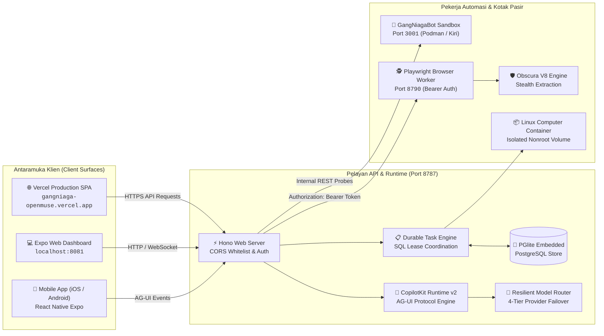
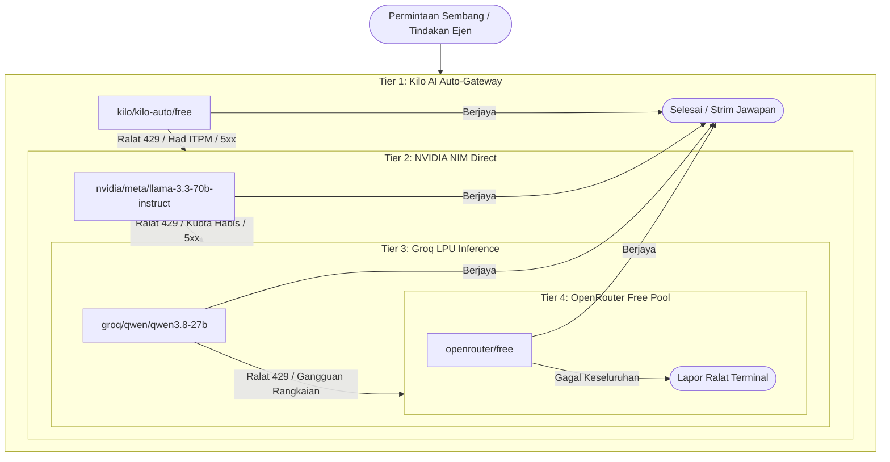
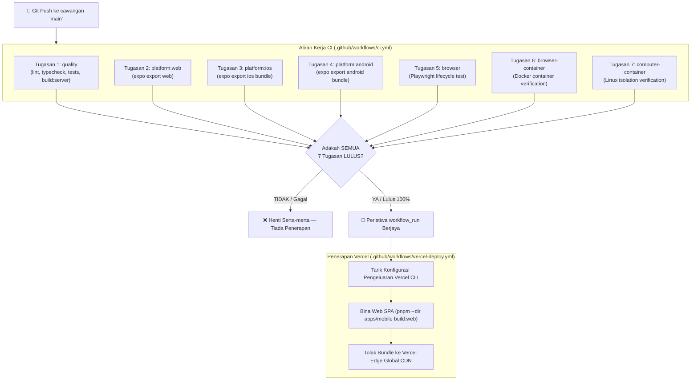

<div align="center">

# 🌌 GangNiaga-OpenMuse

**Sovereign Personal & Enterprise AI Agent Control Plane**  
*Pelan Kawalan Ejen AI Peribadi & Perusahaan Berdaulat Berprestasi Tinggi*

[](https://github.com/GangNiaga/GangNiaga-OpenMuse/actions/workflows/ci.yml)
[](https://gangniaga-openmuse.vercel.app)
[](LICENSE)
[](https://copilotkit.ai)
[](https://tanstack.com)

[Gambaran Keseluruhan](#-gambaran-keseluruhan) · [Senibina & Port](#-senibina--topologi-port) · [Penghalaan Model AI](#-penghalaan-model-ai-berdaya-tahan-4-tier-failover) · [Struktur Monorepo](#-struktur-monorepo) · [Pemasangan](#-panduan-pemasangan--konfigurasi) · [CI/CD & Vercel](#-cicd--penerapan-berpagar-vercel)

</div>

---

## Diagnostics and extraction

Node.js 22.13+ is required, including by PDF.js. Serverless startup requires live mode, an explicit database URL and access/encryption keys. Computer support additionally needs an explicit deployment ID. Startup failures return a generic 503 and request ID. Configure credentials in deployment settings; credential rotation is a separate operational step.

These routes require authentication and retain ownership checks:

| Route | Behavior |
| --- | --- |
| GET /api/tools | Names, descriptions and JSON schemas from actual conversation tool definitions; providers and runtime permissions still apply. |
| GET /api/health/details | Database probe, worker heartbeat and browser/computer/runtime configuration. Public /api/health remains liveness. |
| POST /api/browsers/:id/tables | Bounded HTML table extraction; selector and format (json, csv, markdown). |
| POST /api/browsers/:id/screenshot | PNG; optional clip inside the worker's 1280×800 viewport. |
| POST /api/files/:id/tables | Owned PDF extraction in an isolated cancellable worker: 15 seconds, 10 MB input, 20 pages. |

PDF columns are inferred from text coordinates. Scanned PDFs need OCR elsewhere; merged/wrapped cells require review. CSV neutralizes spreadsheet formula prefixes. Browser egress rejects private/mixed DNS answers and pins validated addresses through the proxy. Obscura uses the same proxy and rejects private-network overrides.

Local computer mode checks workspace paths and symlinks and forwards a minimal environment. Native shell commands still have host-user privileges: choose Docker for isolation. Local tests do not establish production connectivity or deployment. See sibling PILOTKIT for offline and live stack gates.

## 📖 Gambaran Keseluruhan

**GangNiaga-OpenMuse** ialah pelan kawalan (*control plane*) ejen autonomi peribadi dan perusahaan generasi baharu. Sistem ini direka khas untuk menyelaraskan tugasan berterusan (*durable long-running workflows*), penyemakan imbas web pintar (*stealth browser worker*), pengurusan fail dan PDF, serta pelaksanaan arahan terminal selamat dalam kontena terasing.

Dibina dengan teras teknologi termaju:
* **Antaramuka Pengguna (UI)**: Dibina menggunakan **Expo (React Native)** untuk sokongan serentak Web SPA, iOS, dan Android dengan integrasi *headless hooks* **CopilotKit v2** dan penstriman peristiwa protokol **AG-UI**.
* **Pelayan Aplikasi (Server)**: Dikuasakan oleh **Hono** berprestasi tinggi di atas Node.js (LTS), memuatkan pengurusan keadaan berterusan menggunakan **PGlite** (enjin PostgreSQL terbenam berdaya simpan setempat).
* **Penyemak Imbas Ejen (Browser Worker)**: Perkhidmatan terasing **Playwright & Chromium** dengan sokongan profil sesi kekal (*persistent profiles*), kawalan langsung (*Take Control*), dan enjin pemintasan **Obscura V8 Stealth Scraper**.
* **Kotak Pasir Komputer (Computer Sandbox)**: Integrasi pilihan dengan **GangNiagaBot** melalui Docker Engine API, kontena Podman (`libracoder/kiri` v0.2.0), atau persekitaran E2B Desktop. Integrasi memerlukan konfigurasi eksplisit (`OPENBOT_REPO`, token callback); tiada sambungan automatik atau *shared login* di antara kedua-dua aplikasi.

---

## 🏗️ Senibina & Topologi Port

Ekosistem GangNiaga-OpenMuse menghubungkan antaramuka hadapan, pelayan lejar masa nyata, pekerja automasi pelayar, dan enjin pengkomputeran dalam topologi yang kukuh dan selamat:



### Jadual Topologi Port & Titik Akhir (Endpoints)

| Port / URL | Komponen / Servis | Protokol & Kawalan Keselamatan | Penerangan Fungsi |
| :--- | :--- | :--- | :--- |
| **`https://gangniaga-openmuse.vercel.app`** | Production Web Frontend | HTTPS (TLS 1.3 / Vercel Edge) | Antaramuka pengeluaran SPA dengan peraturan penulisan semula (*rewrite*) `/settings` ke `/index.html`. |
| **Port `8081`** | Expo Web / Metro Dev | HTTP (`localhost:8081`) | Papan pemuka pembangunan web tempatan untuk pengujian pantas antaramuka. |
| **Port `8787`** | Hono API & CopilotKit Runtime | HTTP / JSON (`127.0.0.1:8787`) | Titik akhir utama API, penstriman AG-UI, pengurusan fail PDF, semakan tindakan (*review ledger*), dan pemeriksaan kesihatan (`/api/health`). |
| **Port `8790`** | Playwright Browser Worker | HTTP + Bearer Auth Token (`WORKER_TOKEN`) | Servis penyemak imbas Chromium peribadi untuk navigasi web awam, pengekstrakan data, tangkapan skrin, dan pengambilalihan kawalan sesi pengguna. |
| **Port `3001`** | GangNiagaBot Computer Sandbox | HTTP (`127.0.0.1:3001`) | Kotak pasir ejen Podman / Docker Engine API (`libracoder/kiri` v0.2.0) yang mengendalikan automasi terminal dan alatan lanjutan. |

---

## ⚡ Penghalaan Model AI Berdaya Tahan (4-Tier Failover)

Sistem menggunakan penyesuai pintar `createResilientAdapter` yang terletak dalam [`apps/server/src/engine/tanstack-agent.ts`](apps/server/src/engine/tanstack-agent.ts). Penyesuai ini melindungi ejen daripada gangguan had kadar API (*Rate Limit / ITPM caps*) melalui pertukaran pembekal automatik dan telus:



### Mekanisme Penapisan Ralat (`isFailoverEligible`)
* **Layak untuk Failover Otomatik**: Kod status HTTP `429` (Rate limit / ITPM exceeded), `404`, `410`, ralat pelayan `5xx`, beban lampau (*overloaded*), dan gangguan soket rangkaian (`ECONNRESET`, `ETIMEDOUT`, `fetch failed`).
* **Gagal Pantas (Fail-Fast)**: Ralat sintaks atau pengesahan pengguna seperti `400 Bad Request`, `401 Unauthorized`, dan `403 Forbidden` tidak akan dicuba semula ke pembekal lain bagi mengelakkan pembaziran masa dan kitaran tidak sah.
* **Pengasingan Lekapan Ujian**: Model ujian/mock (`openai/fixture`, `mock/*`) diasingkan sepenuhnya daripada rantaian pengeluaran untuk mengelakkan pencemaran log ujian unit.

---

## 📁 Struktur Monorepo

Susun atur kod sumber berstruktur modular di bawah pengurusan pakej `pnpm`:

| Direktori | Komponen / Tanggungjawab | Teknologi Teras |
| :--- | :--- | :--- |
| **`apps/server`** | Pelayan API utama Hono, pengurusan sesi CopilotKit v2, lejar tugas berterusan, pangkalan data PGlite, dan sempadan kawalan tindakan selamat. | Node.js, Hono, PGlite, RxJS, TanStack AI |
| **`apps/mobile`** | Aplikasi lintas platform (Web SPA, iOS, Android) dengan sokongan komponen sembang CopilotKit, kad hasil generatif UI, dan pengurusan tema OLED. | Expo (React Native), TypeScript, Tailwind/NativeWind |
| **`apps/worker`** | Pekerja penyemak imbas automasi berasaskan Playwright dengan pengesahan Bearer Token dan pengurusan profil pengguna kekal. | Playwright, Chromium headless, Node HTTP |
| **`apps/computer`** | Spesifikasi bekas kotak pasir Linux nonroot, pengesahan fail, dan antaramuka Docker/Podman Engine API. | Dockerfile, Bash, TypeScript smoke tests |
| **`packages/domain`** | Model domain bersama, skema pengesahan Zod, dan definisi jenis TypeScript kanonikal. | TypeScript, Zod |
| **`packages/integrations`** | Penyesuai luaran selamat untuk integrasi Google OAuth (Gmail & Google Calendar) dan protokol penyemak imbas. | Google APIs Client, OAuth2 |
| **`packages/backends`** | Penyesuai titik akhir HTTP untuk GangNiagaBot dan OpenBot dengan pengesahan sempadan identiti. | HTTP Client, Agent Adapters |
| **`tests`** | Rangkaian ujian integrasi penuh, ujian keselamatan sempadan CORS, ujian lejar persistensi, dan ujian kontrak pembekal. | Node.js Test Runner, tsx |

---

## 🚀 Panduan Pemasangan & Konfigurasi

### 1. Keperluan Prasyarat
* **Node.js**: Versi `>= 22` (disyorkan Node.js 22 LTS).
* **Pengurus Pakej**: `pnpm` versi `11.19.0` (atau terkini).
* **Persekitaran Kontena (Pilihan)**: Docker Engine atau Podman jika mengaktifkan kotak pasir komputer lokal.

### 2. Langkah Pemasangan

```sh
# 1. Klon repositori rasmi
git clone https://github.com/GangNiaga/GangNiaga-OpenMuse.git
cd GangNiaga-OpenMuse

# 2. Pasang semua kebergantungan monorepo
pnpm install --frozen-lockfile

# 3. Salin templat konfigurasi persekitaran
cp .env.example .env
```

### 3. Konfigurasi Pembolehubah Persekitaran (`.env`)

Edit fail `.env` menggunakan tetapan selamat anda. **AMARAN: Jangan sesekali melakukan komit (*commit*) kunci rahsia sebenar ke dalam kawalan versi git!**

```ini
# Mod Persekitaran & Pelayan
WORKSPACE_MODE=sample
PORT=8787
HOST=127.0.0.1
PUBLIC_API_URL=http://localhost:8787

# Senarai Putih CORS (Wajib untuk akses Web Vercel & Papan Pemuka Lokal)
ALLOWED_ORIGINS=http://localhost:8081,http://127.0.0.1:8081,https://gangniaga-openmuse.vercel.app

# CopilotKit Intelligence Project Key (Diperlukan untuk penyimpanan dan kesinambungan sembang)
# Dapatkan melalui: npx copilotkit@latest login && npx copilotkit@latest project select
CPK_INTELLIGENCE_API_KEY=your_server_intelligence_key_here

# Konfigurasi Pekerja Penyemak Imbas (apps/worker)
BROWSER_WORKER_URL=http://127.0.0.1:8790
WORKER_TOKEN=your_secure_random_worker_token_minimum_32_chars
WORKER_HOST=127.0.0.1

# Konfigurasi Kotak Pasir Komputer (docker | local | e2b-desktop)
COMPUTER_ENABLED=false
COMPUTER_PROVIDER=docker
COMPUTER_IMAGE=openmuse-computer:local

# Pembolehubah Klien Web (Digunakan semasa kompilasi Expo Web)
EXPO_PUBLIC_API_URL=https://gangniaga-openmuse.vercel.app
EXPO_PUBLIC_OPENBOT_URL=http://127.0.0.1:3001
```

### 4. Perintah Pembangunan Tempatan

```sh
# Melancarkan Pelayan Hono API (Port 8787)
pnpm dev

# Melancarkan Antaramuka Web Expo dalam terminal berasingan (Port 8081)
pnpm dev:web

# Melancarkan Pekerja Penyemak Imbas Playwright (Port 8790)
pnpm --dir apps/worker exec playwright install chromium
pnpm dev:browser

# Menjalankan Ujian Unit & Integrasi Keseluruhan
pnpm test

# Menjalankan Pemeriksaan Kualiti Kod (Linting & Jenis)
pnpm lint
pnpm typecheck

# Membina Bundle Web Pengeluaran
pnpm --dir apps/mobile build:web
```

---

## 🛡️ CI/CD & Penerapan Berpagar Vercel

Sistem GangNiaga-OpenMuse menguatkuasakan kawalan kualiti tanpa kompromi melalui seni bina saluran paip berpagar (*gated deployment pipeline*):



### Penghalaan Semula Vercel SPA (`vercel.json`)
Bagi mengelakkan isu ralat `404 Not Found` semasa pengguna menyegarkan semula (*page refresh*) atau mengakses pautan dalaman secara terus seperti `/settings`, konfigurasi kanonikal [`vercel.json`](vercel.json) mengarahkan semua permintaan kembali ke fail indeks SPA:

```json
{
  "$schema": "https://openapi.vercel.sh/vercel.json",
  "buildCommand": "pnpm --dir apps/mobile build:web",
  "outputDirectory": "apps/mobile/dist/web",
  "installCommand": "pnpm install",
  "framework": null,
  "rewrites": [
    {
      "source": "/(.*)",
      "destination": "/index.html"
    }
  ]
}
```

Pengesahan berkala menunjukkan:
* Status URL Akar (`https://gangniaga-openmuse.vercel.app/`): **HTTP `200 OK`**
* Status URL Tetapan (`https://gangniaga-openmuse.vercel.app/settings`): **HTTP `200 OK`**

---

## 📜 Lesen & Penghargaan

* **Lesen**: Dilesenkan di bawah terma [MIT License](LICENSE).
* **Asal**: Diinspirasikan oleh projek sumber terbuka CopilotKit OpenMuse dan dibangunkan semula secara berdaulat untuk ekosistem GangNiaga.
